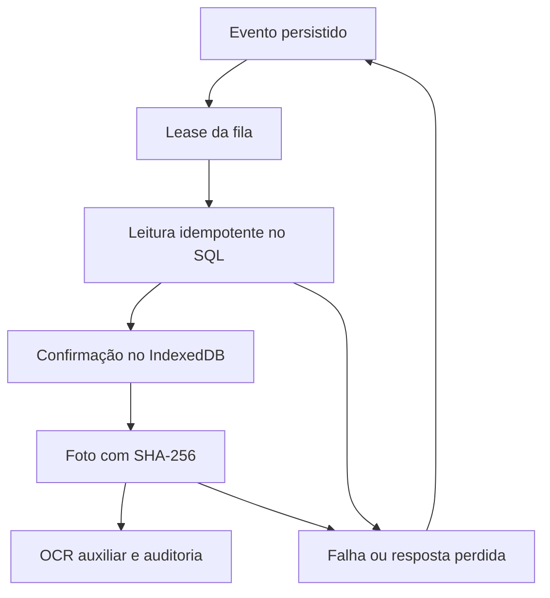

# Fase 12 — confiabilidade, integridade e recuperação

Base c2c5353, merge do PR #21. Branch feat/fase-12-confiabilidade-integridade.

## Correções

| Lacuna | Correção |
| --- | --- |
| Mesmo ClientEventId aceitava outro conteúdo | Compara máquina, valor, tipo, data, obra, correção, autor e dispositivo. Divergência retorna 409. Autor legado ausente é preservado. |
| Avaliações concorrentes da máquina | Transação SQL com sp_getapplock por máquina e timeout de 10s. Execution strategy refaz a operação completa em falha transitória. Índice único continua como garantia final. |
| Retentativa da foto ignorava arquivo | Comprovação de dispositivo e SHA-256 precedem replay. Mesmo evento compara também autor, captura e DeviceId. Corrida compara hash e leitura. |
| Falha de confirmação SQL podia apagar blob válido | Em commit incerto retém objeto com log de IDs e correlação. Só a violação única com rollback conhecido compensa o upload perdedor. |
| Retenção removia pai de foto pendente | Evento de leitura permanece enquanto houver filho sem confirmação. |
| Lock fallback limitado à aba | Lease persistido em transação IndexedDB, expira em 120s e renova antes de cada evento. Web Locks permanece complementar. |
| 409 tratado como sucesso por ter ID | Conflito requer intervenção. Confirmação usa 2xx com identificador. |
| Retentativas | Backoff exponencial desde 5s até 30min, jitter até 25%, Retry-After em segundos ou data. Espera mínima do servidor também vale no reenvio manual. |
| Ciclo sem limite | 50 eventos por ciclo, uma tentativa por evento, retomada dos elegíveis após 1s. |
| Cancelamento | AbortSignal opcional e timeout de transporte de 30s. Preserva evento e identificador para reenvio. |
| Falhas transitórias | Timeout, deadlock e app lock indisponível retornam 503 e Retry-After 5. Cancelamento do cliente retorna 499. Resposta pública omite detalhes internos. |
| Observabilidade | Contador e histograma HTTP em System.Diagnostics.Metrics. Tags de rota normalizada, método e status. Reutiliza logs estruturados e correlation ID. |

## Fluxo e garantias

Leitura, foto e identificadores são capturados em uma transação IndexedDB. Estados e versões persistidos são preservados. retryNotBefore é opcional e compatível com eventos anteriores.

SaveChanges e commit SQL precedem sucesso HTTP. A transação da leitura inclui anomalias, auditoria e atualização do dispositivo quando necessária. Histórico permanece imutável. O lock por máquina faz cada avaliação observar os eventos já confirmados. Leituras fora de ordem preservam a interpretação feita na chegada. Diferenças históricas não são recalculadas retrospectivamente.

Foto é gravada antes do metadata SQL. Uma falha ambígua pode deixar objeto sem referência. A reconciliação precede qualquer exclusão, protegendo fotos válidas. Não há transação distribuída.

## Recuperação

- 401 interrompe o ciclo e solicita sessão, mantendo dados.
- 400, 403, 404, 409, 413 e 422 exigem intervenção.
- 408, 425, 429, 5xx e falha de comunicação permitem nova tentativa controlada.
- SYNCING interrompido é recuperado após aquisição exclusiva do lease.
- Foto só é enviada após confirmação do pai.
- Falha OCR preserva foto e leitura. Um PROCESSING inicial após término abrupto exige consulta e reprocessamento administrativo após o intervalo de segurança. Não foi criado worker automático.

## Testes e evidências

Testes frontend adicionais cobrem lease concorrente e expirado, retenção do pai, Retry-After, cancelamento e ciclo limitado. Os existentes cobrem reabertura IndexedDB, sessão expirada, rede, dispositivo e recuperação.

Testes SQL adicionais cobrem payload divergente, seis reenvios simultâneos, confirmação perdida, duas leituras distintas, rollback de auditoria, timeout de lock com 503 e recuperação. A suíte existente cobre decisões concorrentes, upload repetido, falha OCR e revogação. A CI executa SQL Server 2022 descartável com o guard existente de nomes de banco. O ambiente local não dispõe de SQL Server ou Docker.

Resultados locais e CI serão consolidados após execução.

## Diagnóstico operacional

1. Localizar correlation ID, status HTTP e duração nos logs.
2. Conferir o estado e ClientEventId da fila sem limpar o IndexedDB.
3. Consultar evento SQL e auditoria antes de repetir.
4. Conferir metadata e hash da fotografia. Objetos de commit incerto ficam retidos até reconciliação.
5. Para OCR interrompido, consultar histórico e reprocessar pela supervisão após intervalo. Preservar a leitura original.
6. Para 401 recuperar sessão. Para revogação, encaminhar pendência à supervisão.
7. Para 503 aguardar Retry-After e conferir SQL/storage. Reenviar com o ClientEventId original.

## Implantação

Não há migrations novas. Todas as migrations anteriores, inclusive AddReadingReviews, permanecem intactas. Não há serviço ou plano Azure adicional. Health existente já verifica SQL e foi considerado suficiente como prontidão básica. Testes de endpoint continuam necessários.

Após aprovação, publicar API e frontend pelos workflows existentes. Verificar health, um reenvio controlado em homologação, erros e latência. Rollback usa o artefato anterior e mantém estrutura IndexedDB compatível.

## Riscos residuais

- Blobs de commit ambíguo podem consumir espaço até reconciliação.
- Suspensão longa da aba pode expirar o lease. SQL e índice único da foto continuam protegendo duplicidades.
- Evicção ou limpeza manual do navegador exige procedimento operacional do aparelho. IndexedDB não é backup externo.
- Recuperação OCR após morte abrupta do processo é administrativa.
- App Service com suspensão, quota ou storage efêmero mantém limitações do plano. Conferir storage persistente no rollout.
- Revogação é validada a cada tentativa. Operação já admitida pode terminar durante revogação. Novas tentativas recebem 403.
- Fase 16 cobre testes físicos de QR, câmera, OCR com imagens reais e conectividade em campo.

Prontidão depende de CI verde no commit final e revisão do PR. Implantação e aceite em produção dependem de aprovação posterior.
