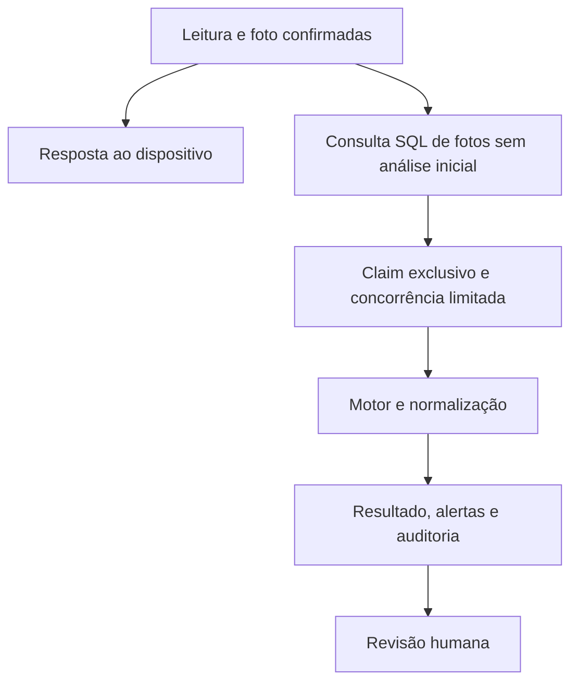

# Fase 13 — OCR e qualidade das leituras

Base f44650d, que contém o merge do PR #22. Branch feat/fase-13-ocr-qualidade.

## Normalização e confiança

O extrator meter-normalization-v2 aceita inteiros, duas casas decimais, zeros à esquerda, agrupamentos brasileiros e internacionais completos. Exemplos 4.850,7 e 1,250.5 resultam em 4850.7 e 1250.5. Um separador seguido por três dígitos é conservadoramente ambíguo. Em 1.250, os candidatos 1250 e 1.25 são preservados. O domínio limita os valores a 9999999999.99 e duas casas decimais.

O contexto da unidade filtra HOURS/KM. Prefixos de série, modelo, RPM, combustível, temperatura e percentuais são descartados. Números em texto sem contexto suficiente não viram leitura. Há limite de 4000 caracteres, 20 candidatos e regex com timeout de 100ms. Token malformado não é parcialmente aceito.

Confiança é exclusivamente o score das palavras numéricas fornecido pelo motor. Um score ausente não é convertido em sucesso confiável. Resultado com valor e confiança ausente ou abaixo do mínimo fica LOW_CONFIDENCE. Sem valor ou com ambiguidade fica NO_VALUE_DETECTED. Falha do provider ou interrupção fica FAILED. Não há percentual de precisão medido nesta fase.

A diferença para o valor manual usa os limites absolutos e percentuais configuráveis existentes. O valor da leitura anterior é obtido pelo vínculo histórico persistido, respeitando a unidade. A compatibilidade com o histórico é exibida separadamente da confiança visual. Nenhum desses resultados modifica o registro original.

## Persistência e reprocessamento

A migration 20261112180316_AddOcrQualityMetadata acrescenta seis campos opcionais ao histórico OCR, com versão do algoritmo, motivo de revisão, candidatos, chave idempotente e contexto da leitura anterior. Mantém todas as migrations anteriores. O índice único filtrado da chave de reprocessamento permite múltiplos resultados legados com valor nulo. O status funciona como token de concorrência EF.

Idempotency-Key é um UUID opcional no endpoint de reprocessamento. O mesmo autor, chave e evidência retornam o resultado persistido, inclusive se ainda em processamento. Reutilização com outra evidência ou autor retorna 409. Chamadas antigas sem chave continuam protegidas pelo cooldown. O frontend mantém a chave por usuário/leitura em sessionStorage até receber o resultado terminal da tentativa.

O claim SQL existente serializa tentativas por evidência. Resultados finalizados permanecem imutáveis. A recuperação marca claims abandonados como FAILED/OCR_INTERRUPTED após timeout + 45 segundos, com auditoria. O token de concorrência impede que um processador antigo sobrescreva essa finalização. A supervisão pode criar uma nova análise, preservando a anterior.

## Processamento em segundo plano e offline

O worker usa as fotos confirmadas sem análise prévia e o índice de resultado inicial como fonte durável de trabalho. Reinícios preservam os trabalhos sem depender de notificações em memória. Não há nova fila externa. O padrão consulta a cada 5 segundos e processa lote de até 2 fotos. A concorrência é configurável entre 1 e 4 por processo, compartilhada com os reprocessamentos manuais. Timeout inclui espera pelo slot. Persistência final dispõe de prazo próprio de 30 segundos, independente da desconexão do cliente.

O upload não aguarda o reconhecimento. A fila offline continua confirmando leitura e foto pelos contratos da Fase 12. A opção Ocr:BackgroundProcessingEnabled=false mantém o modo síncrono para testes de compatibilidade e diagnóstico. Os testes da nova modalidade executam o worker habilitado em SQL descartável.

## Alertas e revisão administrativa

Baixa confiança e resultados inconclusivos usam LOW_OCR_CONFIDENCE. Divergência usa OCR_OPERATOR_DIVERGENCE. Falhas recorrentes geram aviso após Ocr:FailuresBeforeAlert, padrão 2. As regras manuais de redução e aumento impossível permanecem no serviço de leituras.

Antes de criar aviso, o serviço consulta os resultados da mesma evidência. Um aviso equivalente, inclusive resolvido, impede duplicação e reabertura automática. A interpretação continua disponível no novo resultado e no histórico, para a revisão administrativa existente.

O painel apresenta fotografia, contexto da máquina e obra, valor manual e detectado, diferenças, confiança do motor, contexto anterior, candidatos, motivo, texto bruto e versão, além do histórico administrativo. A atualização automática é limitada a 24 consultas de 5 segundos enquanto aguarda o resultado. Reprocessamento possui confirmação e chave idempotente.

## Segurança e privacidade

Operadores consultam apenas a própria evidência e seu resultado básico. Leituras legadas sem autoria identificável exigem supervisão para a foto. A mesma regra protege metadata, conteúdo e resultado OCR. UUIDs de terceiros retornam 404. Supervisores mantêm acesso administrativo. Texto bruto e candidatos são omitidos da resposta operacional e a interface também os restringe por papel.

Os controles de autenticação, CSRF, tamanho, tipo de arquivo, hash e rate limiting são reaproveitados. Texto OCR é renderizado como texto escapado. Logs registram IDs, status, duração e correlação, sem imagens, texto bruto ou credenciais. A segurança da Fase 11 é mantida e a exposição transversal de fotografias foi reduzida.

## Pré-processamento e avaliação

Foi avaliada a introdução de rotação, contraste, recorte e perspectiva. Não há corpus autorizado representativo que demonstre ganho. Não foram adicionadas transformações ou dependências de imagem pesadas. O motor existente recebe a evidência original validada. O OCR limita cada dimensão a 12000 pixels e a imagem a 50 milhões de pixels, configuráveis. Evidências maiores são preservadas e recebem falha controlada antes de consultar o provider. O adaptador também limita a leitura do stream a 10 MB e a resposta externa a 1 MB, mesmo se o storage estiver inconsistente. O teste de extração usa respostas OCR sintéticas e não mede acurácia de visão em fotografias reais.

Displays mecânicos, reflexos, poeira, perspectiva e baixa iluminação continuam sujeitos ao motor e à qualidade da fotografia. Candidatos e revisão humana evitam interpretar números ambíguos como certeza. A Fase 16 avaliará captura e OCR em campo.

## Testes e implantação

Testes novos cobrem formatos, ambiguidade, limite de candidatos, confiança ausente, contexto de unidades, cancelamento de slot, autorização de fotos, detalhes administrativos, worker assíncrono, recuperação de claims, chave reutilizada concorrentemente entre evidências, falhas recorrentes e reprocessamento idempotente sem reabrir alertas resolvidos. As suítes anteriores permanecem como regressão.

A execução [43279524509](https://github.com/EduardoStuhr/TransjapHorimetros/actions/runs/43279524509) aprovou a implementação no commit ddf437a5a9671e205757777485a97efa06cedd5b.

| Verificação | Resultado |
| --- | --- |
| Build Release backend | Aprovado, zero avisos e zero erros |
| Testes unitários .NET | 258 aprovados, zero falhas e zero ignorados |
| Integração SQL Server descartável | 222 aprovados, zero falhas e zero ignorados |
| Frontend | 108 aprovados em 13 arquivos |
| Lint e build de produção | Aprovados |
| Total | 588 testes aprovados |

O SQL real confirmou classificação e candidatos, confiança ausente, normalização brasileira, preservação da leitura e foto, limites de resolução sem chamada ao motor, autorização por autoria, texto administrativo restrito, recuperação auditada, upload desacoplado, chave idempotente, conflito concorrente entre evidências e alerta único após falha recorrente. Os testes da interface verificam o HTML renderizado dos estados e a restrição de detalhes por papel. Não constituem validação visual em aparelho físico.

O script EF incremental foi gerado e revisado. Acrescenta apenas seis colunas opcionais, índice filtrado e registro de migration. Não contém UPDATE, DELETE ou DROP no caminho Up. O modelo sem alterações pendentes foi verificado na suíte. SQL Server real descartável foi executado pela CI e o ambiente local não dispõe de SQL Server. Não foram utilizados dados ou fotografias reais de produção.

A Fase 13 está pronta para revisão do PR #23 e homologação controlada após aprovação. A precisão visual em fotografias reais será avaliada na Fase 16.

A implantação requer autorização para a migration incremental antes de publicar a API nova. Gerar o script EF entre AddReadingReviews e AddOcrQualityMetadata, revisar, conferir destino, PITR e contagens, aplicar sob autorização e validar o histórico. O script Up acrescenta campos e índice, sem modificar leituras ou fotografias. Rollback de código pode manter as colunas opcionais. Down remove os metadados novos e exige recuperação/backup desses dados antes de ser considerado.

Não foram contratados serviços nem ativado provider pago. A configuração existente de provider é preservada. O provider Fake retorna ausência de detecção e não fabrica valores. Avaliar provider real e seus custos depende de configuração autorizada.

## Limitações e riscos residuais

- Worker depende do processo App Service ativo. Suspensão do plano adia o reconhecimento até a retomada.
- O limite de concorrência é por processo. Claims SQL por evidência protegem múltiplas instâncias, mas o limite agregado depende da quantidade de instâncias existentes.
- Um provider precisa honrar o cancelamento. O adaptador HTTP utiliza o token e timeout do processamento.
- Recuperação de estado PROCESSING é periódica. Resultado interrompido requer uma nova ação administrativa para reprocessar.
- Não há precisão de OCR em campo homologada. Pré-processamento adicional exige corpus autorizado e medição.
- A migration não foi aplicada no Azure. Implantação e verificação de produção dependem de aprovação.
